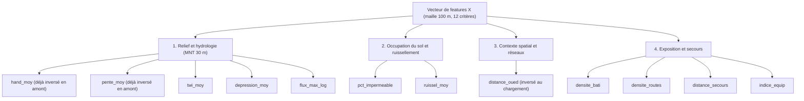

# Formulation du Problème Geo-AI

**Projet :** Évaluation et typologie du risque d'inondation urbaine — région Casablanca-Settat
**CRS de référence :** EPSG:26191 (Merchich / Nord Maroc)

---

## 1. Énoncé formel et paradigme d'apprentissage

Le problème est formalisé comme une tâche d'**apprentissage spatial non supervisé (clustering / typologie multicritère)**, articulée avec une **évaluation multicritère experte (AHP — Analytic Hierarchy Process)**.

* **Type de tâche :** partitionnement non supervisé de mailles en types de risque, puis classement ordinal des types en priorités P1 à P5. Il ne s'agit ni d'une prédiction d'événements observés, ni d'une détection d'objets, ni d'une segmentation d'images : les entrées sont des attributs tabulaires dérivés de couches raster et vectorielles.
* **Modèles retenus :**
  * **Baseline :** K-Means ($k = 5$).
  * **Modèle principal :** GMM — Gaussian Mixture Model ($k = 5$, covariance pleine *full*).
* **Support géographique :** maille régulière carrée de 100 m × 100 m (1 ha).
* **Volumétrie :** 2 020 705 mailles couvrant la région Casablanca-Settat. L'analyse communale porte sur 153 communes.
* **Rôle de l'AHP :** (1) pondérer les variables avant le clustering (chaque variable est multipliée par $\sqrt{w_i}$), (2) ordonner les clusters en priorités (score AHP moyen décroissant), (3) fournir la référence d'évaluation supervisée.

---

## 2. Variables cibles (sorties)

| Variable | Type | Origine | Signification |
|---|---|---|---|
| **`score_ahp`** | Continu $\in [0, 1]$ | AHP, $Y = \sum w_i X_i$ | Score synthétique de risque d'inondation (référence d'expert). |
| **`classe_ahp`** | Ordinal $\in \{1,\dots,5\}$ | Discrétisation du score AHP | 1 = très faible … 5 = très élevé. |
| **`cluster_id`** | Catégoriel, $k = 5$ par modèle | K-Means (id 1 à 5), GMM (id 6 à 10) | Type de risque découvert par les données. |
| **`priorite`** | Ordinal $\in \{1,\dots,5\}$ | Rang du cluster par score AHP moyen | **1 = plus urgent** (attention : l'échelle est inverse de `classe_ahp`). |
| **`probabilite`** | Continu $\in [0, 1]$ | GMM : $P(C_k \mid \text{maille})$ ; K-Means : 1 | Certitude d'appartenance au cluster attribué. |
| **`indice_priorite`, `rang_priorite`** | Continu / entier | Agrégation par commune | Priorisation des 153 communes (voir section 6). |

### Typologie obtenue (GMM, modèle principal)

Les clusters ne sont pas définis a priori : chacun est nommé d'après sa variable dominante (score z le plus élevé de son profil moyen).

| Priorité | Cluster | Libellé | Score AHP moyen | Mailles (région) |
|---|---|---|---|---|
| P1 | 7 | Risque très élevé — dominante `twi_moy` | 0,459 | 199 546 |
| P2 | 9 | Risque élevé — dominante `pct_impermeable` | 0,418 | 45 726 |
| P3 | 6 | Risque modéré — dominante `distance_oued` | 0,371 | 1 000 603 |
| P4 | 10 | Risque faible — dominante `distance_secours` | 0,370 | 540 142 |
| P5 | 8 | Risque très faible — dominante `indice_equip` | 0,277 | 234 688 |

À chaque priorité est associée une intervention type (aménagement hydraulique, gestion des eaux pluviales, protection des berges, maîtrise de l'urbanisation, accès aux secours), choisie d'après la famille de la variable dominante.

---

## 3. Variables explicatives (matrice des features $X$)

Chaque maille est décrite par 12 critères normalisés sur $[0, 1]$, orientés pour que **1 corresponde au niveau de risque le plus défavorable**.

### Spécification détaillée

| Critère | Famille | Source | Orientation du risque | Poids AHP |
|---|---|---|---|---|
| `hand_moy` | Aléa — hydro | DEM + hydrographie | HAND faible = risque fort ; **déjà inversé** dans le CSV normalisé (`benefit` dans l'AHP) | 0,219 |
| `flux_max_log` | Aléa — hydro | DEM, accumulation D8, $\ln(1+x)$ | Direct | 0,129 |
| `twi_moy` | Aléa — hydro | DEM (pente et flux) | Direct | 0,129 |
| `distance_oued` | Aléa — oued | Hydrographie OSM | Proximité = risque fort ; `cost`, **inversé ($1-x$) au chargement dans le notebook** | 0,129 |
| `depression_moy` | Aléa — hydro | DEM comblé − DEM brut | Direct | 0,072 |
| `ruissel_moy` | Aléa — sol | OSM landuse | Direct | 0,072 |
| `pente_moy` | Aléa — hydro | DEM | Pente faible = risque fort ; **déjà inversé** dans le CSV normalisé (`benefit` dans l'AHP) | 0,042 |
| `pct_impermeable` | Aléa — sol | Bâti + landuse + voirie | Direct | 0,042 |
| `densite_bati` | Vulnérabilité | OSM buildings | Direct | 0,071 |
| `densite_routes` | Vulnérabilité | OSM routes | Direct | 0,038 |
| `distance_secours` | Vulnérabilité | Réseau routier OSM (Dijkstra) | Direct | 0,038 |
| `indice_equip` | Vulnérabilité | OSM POI | Direct | 0,020 |

**Répartition des poids :** l'aléa pèse environ 83 % (somme de 0,834) et la vulnérabilité environ 17 % (0,167). Le score AHP est donc surtout un score d'aléa. Il est utile de cartographier séparément `score_alea` et `score_vulnerabilite` : un cluster peut être un aléa fort sans enjeu (zone rurale) ou un aléa moyen avec forts enjeux.

**Contexte spatial :** il n'entre dans le modèle que par des variables dérivées (distances, accumulation de flux). Chaque maille est classée indépendamment de ses voisines ; les coordonnées servent uniquement au découpage train/test.

---

## 4. Constitution du jeu d'entraînement et de test

Aucun modèle pré-entraîné n'est réutilisé : K-Means et GMM sont entraînés de zéro, il n'y a donc pas de fine-tuning.

1. **Découpage spatial par blocs de 5 km** (905 blocs). Un tirage aléatoire de maille à maille placerait des voisines quasi identiques dans le train et le test et gonflerait les scores par autocorrélation spatiale. Avec une graine fixe ($42$), 20 % des blocs (181) forment le test : **1 597 429 mailles en entraînement, 423 276 en test (20,9 %)**.
2. **Choix de $k$ et de la covariance** : uniquement dans le train, par validation croisée à 3 plis par blocs (GroupKFold), sur un sous-échantillon de 100 000 mailles.
3. **Entraînement final** de K-Means et GMM sur le train seul.
4. **Évaluation** sur le test seul. La silhouette est calculée sur un échantillon de 20 000 mailles de test.
5. **Prédiction sur toutes les mailles** (train et test) uniquement pour les cartes et l'agrégation par commune, jamais pour l'évaluation.

### Choix de $k = 5$ (automatique)

* $k$ admissibles après filtres (stabilité ARI ≥ 0,70 et plus petit cluster ≥ 1 %) : 4, 5, 6.
* Trois critères en coude (ICL, log-vraisemblance en validation, variance AHP expliquée $\eta^2$) votent tous pour 5.
* À $k = 5$ : ARI de stabilité = 0,861, plus petit cluster = 2,4 % des mailles. `K_MANUEL = None`, donc le choix est automatique.

---

## 5. Protocole d'évaluation et résultats

### 5.1 Évaluation sur le jeu de test

| Modèle | Accuracy | Précision macro | Rappel macro | F1 macro | RMSE score | Silhouette | Davies-Bouldin | Calinski-Harabasz |
|---|---|---|---|---|---|---|---|---|
| Référence naïve (classe majoritaire) | 0,7606 | 0,1521 | 0,2000 | 0,1728 | 0,0574 | — | — | — |
| K-Means (baseline) | 0,8396 | 0,3587 | 0,3168 | 0,3269 | **0,0340** | **0,2524** | **1,2595** | **133 882,5** |
| **GMM (modèle)** | **0,8543** | **0,4662** | **0,4322** | **0,4467** | 0,0404 | 0,1507 | 1,5980 | 52 015,5 |

Pour les métriques supervisées, chaque cluster reçoit la classe AHP la plus fréquente dans le **train**, puis cette correspondance est appliquée au test.

### 5.2 Lecture des résultats

* **L'accuracy est trompeuse :** la référence naïve atteint déjà 0,761 car une classe domine. Les métriques macro (F1 : 0,447 pour le GMM contre 0,173 pour la référence) sont plus informatives.
* **Le GMM est meilleur sur l'accord avec l'AHP** (précision, rappel, F1 macro), ce qui justifie son choix comme modèle principal, avec en plus des probabilités d'appartenance.
* **K-Means est meilleur sur le RMSE et sur les métriques internes**, ce qui est attendu : silhouette, Davies-Bouldin et Calinski-Harabasz favorisent des clusters compacts et convexes, ce que K-Means optimise. Le GMM produit des clusters qui se chevauchent.
* **Les cibles initiales ne sont pas atteintes** : silhouette > 0,40 et Davies-Bouldin < 1,0 n'étaient pas atteints par les deux modèles. Des silhouettes de 0,15 à 0,25 indiquent un continuum de risque plutôt que des groupes nets.
* Le BIC du GMM vaut $-1{,}05 \times 10^8$ ; il sert d'indicateur de qualité d'ajustement mais pas de critère unique pour $k$.

### 5.3 Limites

* **Référence non indépendante :** la classe AHP est construite avec les mêmes critères et les mêmes poids que les features. Les métriques supervisées mesurent l'accord avec l'AHP, pas la capacité à retrouver des inondations réelles.
* **Poids experts :** ils ne sont pas appris ; leur sensibilité (variation de ±20 %) n'est pas testée.
* **Pas d'intervalle de confiance :** l'autocorrélation spatiale réduit fortement l'échantillon effectif des 423 276 mailles de test.
* **Normalisation min-max** faite en amont sur toutes les mailles, donc une très légère fuite d'information entre train et test.

### 5.4 Validation métier qualitative

Une liste de 13 lieux réputés exposés (rayon de 2 km) est contrôlée par la part de mailles en P1 + P2 (GMM). Quelques résultats : Aïn Sebaâ 89,4 %, El Jadida 87,4 %, Berrechid 82,0 %, Settat 80,4 %, Mohammedia 79,8 %. Ce contrôle est qualitatif et ne remplace pas une vérité terrain.

### 5.5 Validation prévue (non réalisée dans le notebook)

* **Taux de capture :** proportion des points noirs historiques d'inondation situés dans les mailles de priorité élevée, avec un seuil visé de 75 % :
  $$TC = \frac{\text{points noirs dans les mailles P1 + P2}}{\text{nombre total de points noirs}}$$
  Cette validation exige un inventaire de points noirs géoréférencés, qui n'est pas exploité dans le notebook actuel.
* **Stabilité d'échelle (MAUP) :** comparaison avec une grille de 50 m.

---

## 6. Agrégation par commune (aide à la décision)

Les mailles sont rattachées à leur commune par leur centroïde (153 communes, aucune maille sans commune). Pour chaque commune :

* `pct_zones_elevees` : part de mailles de priorité ≤ 2 (P1 + P2) ;
* `score_moyen`, `score_max` : statistiques du score AHP ;
* `indice_priorite` : combinaison pondérée de composantes normalisées, avec les poids nominaux 0,45 (`pct_zones_elevees`), 0,35 (`score_moyen`) et 0,20 (bâti exposé). Le bâti exposé n'étant pas renseigné, les poids effectifs sont 0,562 et 0,437 ;
* `rang_priorite` et recommandation : « très prioritaire » (10 % des meilleurs rangs), « prioritaire » (jusqu'à 30 %), « suivi » (le reste), accompagnée de l'intervention type du cluster dominant.

---

## 7. Traçabilité et intégration en base (PostGIS)

Les résultats sont enregistrés dans la base `geoai_casablanca`, avec le même CRS (EPSG:26191) :

| Table | Contenu |
|---|---|
| `couche_inondation_derivee_mailles` | Couche d'analyse dérivée : carrés de 100 m de la zone de Casablanca, avec cluster, priorité, libellé, score et probabilité des deux modèles. Géométrie `POLYGON`, SRID 26191, clé primaire `maille_id`, index spatial GiST. |
| `clustering_metadonnees_tracabilite` | Une ligne par modèle : type, rôle, nombre de clusters, covariance, graine, taille des blocs, part de test, nombre de mailles train/test, date d'entraînement, date de traitement et métriques obtenues sur le test. |

La couche est reliée à la table de métadonnées par la clé étrangère `(calcul_id, modele_retenu_id) → (calcul_id, id)`, de sorte que chaque maille est rattachée au modèle, à la date et aux métriques qui l'ont produite.

---

## 8. Résumé

Typologie non supervisée du risque d'inondation sur grille de 100 m, à partir de 12 attributs topo-hydrologiques, de surface et d'exposition pondérés par un AHP. Le modèle principal (GMM, $k = 5$) atteint un F1 macro de 0,447 et une exactitude de 0,854 sur un jeu de test spatialement séparé. Les clusters sont ordonnés en priorités P1 à P5 puis agrégés par commune. Le résultat mesure la cohérence avec la référence AHP ; la validation sur des inondations observées reste à faire.
