# Fiche de Cadrage Méthodologique : Formulation du Problème Geo-AI

**Projet :** Évaluation et Typologie de la Vulnérabilité aux Inondations Urbaines — Grand Casablanca   
**CRS de Référence :** EPSG:26191 (Lambert Conforme Conique Merchich — Nord Maroc)  

---

## 1. Énoncé Formel & Paradigme d'Apprentissage

Le problème est formalisé comme une tâche d'**apprentissage spatial non supervisé (Clustering / Segmentation typologique multi-critères)** articulée avec une **évaluation multicritère experte (AHP - Analytic Hierarchy Process)**.

* **Type de tâche :** Segmentation spatiale et partitionnement non supervisé.
* **Modèles retenus :**
  * **Modèle Baseline :** **K-Means** ($k = 4$, partitionnement dur basé sur la distance euclidienne multidimensionnelle).
  * **Modèle Principal :** **GMM (Gaussian Mixture Models)** ($k = 4$, covariance pleine *full*), fournissant un partitionnement probabiliste avec un degré de certitude d'appartenance par maille.
* **Support Géographique Élémentaire :** La **Maille régulière carrée de 100 m × 100 m** ($1\text{ ha} = 10\,000\text{ m}^2$).
* **Volumétrie :** $2\,020\,705$ mailles régionales couvrant la région Casablanca-Settat.

---

## 2. Définition des Variables Cibles (Outputs du Modèle $Y$)

Le système produit trois variables spatiales cibles complémentaires :

| Variable Cible | Type Mathématique | Modèle Générateur | Signification et Utilisation Métier |
|---|---|---|---|
| **`score_ahp`** | Continu $\in [0, 1]$ | AHP ($Y = \sum w_i X_i$) | Score synthétique de vulnérabilité globale face à l'inondation. |
| **`classe_risque`** | Ordinal $\in \{1, 2, 3, 4, 5\}$ | Discrétisation AHP | 1 : Très Faible, 2 : Faible, 3 : Modéré, 4 : Élevé, 5 : Très Élevé. |
| **`cluster_id`** | Catégoriel $\in \{1, 2, 3, 4\}$ | K-Means / GMM | **Typologie du risque :** • **C1 : Cœur urbain dense hyper-imperméable** (aléa ruissellement pluvial). • **C2 : Bas-fonds alluviaux à proximité d'oueds** (aléa débordement de cours d'eau / faible HAND). • **C3 : Secteur périurbain / agricole perméable** (faible exposition humaine). • **C4 : Secteur enclavé éloigné des centres de secours** (déficit d'évacuation d'urgence). |
| **`probabilite`** | Continu $\in [0, 1]$ | GMM | Probabilité a posteriori $P(C_k \mid \text{maille})$ d'appartenir au cluster attribué. |

---

## 3. Dictionnaire des Variables Explicatives (Matrice des Features $X$)

Chaque maille est décrite par un vecteur multidimensionnel normalisé sur l'intervalle $[0, 1]$, où **la valeur 1 correspond systématiquement au niveau de risque le plus défavorable**.

```mermaid
flowchart TD
    A["Vecteur de Features X (Maille 100 m)"] --> B["1. Morphologie & Relief (MNT DEM 30 m)"]
    A --> C["2. Occupation du Sol & Anthropique (OSM)"]
    A --> D["3. Contexte Spatial & Topologie Réseau"]

    B --> B1["pente_moy : Pente moyenne (Sens Inverse)"]
    B --> B2["hand_moy : Hauteur relative au lit d'oued (Sens Inverse)"]
    B --> B3["twi_moy : Topographic Wetness Index (Sens Direct)"]
    B --> B4["depression_moy : Profondeur des cuvettes (Sens Direct)"]
    B --> B5["flux_max_log : Accumulation de flux amont en log(1+x) (Sens Direct)"]

    C --> C1["densite_bati : Surface bâtie / 10 000 m² (Sens Direct)"]
    C --> C2["pct_impermeable : Taux d'imperméabilité Bâti+Voirie+Sol (Sens Direct)"]
    C --> C3["ruissel_moy : Coefficient moyen de ruissellement pondéré (Sens Direct)"]
    C --> C4["indice_equip : Somme pondérée des POIs sensibles (Sens Direct)"]

    D --> D1["distance_oued : Distance euclidienne au cours d'eau (Sens Inverse)"]
    D --> D2["distance_secours : Distance réseau Dijkstra aux casernes (Sens Direct)"]
    D --> D3["densite_routes : Linéaire routier / surface maille"]
```

### Spécification Détaillée des Features

| Catégorie | Nom de la Feature | Source de Données | Méthode de Normalisation | Sens Métier |
|---|---|---|---|---|
| **MNT / Relief** | `pente_moy_norm` | DEM Copernicus 30 m | $1 - \text{MinMax}(X)$ | **Inverse (Coût) :** Sur terrain plat l'eau stagne $\rightarrow$ Pente faible = Risque fort (1). |
| | `hand_moy_norm` | DEM + Hydrographie | $1 - \text{MinMax}(X)$ | **Inverse (Coût) :** Altitude relative au lit d'écoulement. Plus la valeur est faible, plus la crue atteint la zone. |
| | `twi_moy_norm` | DEM (Pente & Flux) | $\text{MinMax}(X)$ | **Direct :** Indice d'humidité topographique (saturation naturelle des sols). |
| | `depression_moy_norm`| DEM Comblé - DEM Brut | $\text{MinMax}(X)$ | **Direct :** Profondeur des cuvettes topographiques retenant les eaux stagnantes. |
| | `flux_max_log_norm` | DEM Accumulation D8 | $\text{MinMax}(\ln(1 + X))$ | **Direct :** Surface drainée en amont convergeant vers la maille (transformation log pour corriger l'asymétrie). |
| **Anthropique** | `densite_bati_norm` | OSM Buildings | $\text{MinMax}(X)$ | **Direct :** Emprise au sol bâtie par maille (vulnérabilité des personnes et des biens). |
| | `pct_impermeable_norm`| Bâti + Landuse + Voirie | $\text{MinMax}(X)$ | **Direct :** Taux de surface artificialisée empêchant l'infiltration des eaux de pluie. |
| | `ruissel_moy_norm` | OSM Landuse | $\text{MinMax}(X)$ | **Direct :** Coefficient de ruissellement pondéré (0.20 appliqué aux zones blanches). |
| | `indice_equip_norm` | OSM POIs | $\text{MinMax}(X)$ | **Direct :** Somme des poids des équipements sensibles (santé, enseignement, secours). |
| **Spatial** | `distance_oued_norm` | Waterways OSM / Carto | $1 - \text{MinMax}(X)$ | **Inverse (Coût) :** Proximité du cours d'eau. Plus on est proche, plus l'exposition est forte. |
| | `distance_secours_norm`| Réseau routier OSM | $\text{MinMax}(X)$ | **Direct :** Distance réelle de parcours (Dijkstra) jusqu'à la caserne de pompiers la plus proche. |

---

## 4. Protocole d'Évaluation et Validation Spatiale

L'évaluation de la modélisation combine deux niveaux de validation :

### 1. Métriques Intrinsèques (Performance du Clustering)
* **Score de Silhouette ($S$) :** Évalue la compacité intra-cluster et la séparation inter-cluster ($S > 0.40$ visé).
* **Indice de Davies-Bouldin ($DB$) :** Mesure la similarité moyenne entre chaque cluster et son plus proche voisin ($DB < 1.0$ visé).
* **Critère d'Information Bayésien (BIC) :** Utilisé pour calibrer le nombre optimal de composantes $k$ du modèle GMM et éviter le surapprentissage.

### 2. Validation Spatiale Métier (Vérité Terrain / Ground Truth)
* **Couche de Référence :** Inventaire des **Points Noirs d'inondation historiques** (`PointNoir`) recensés lors des épisodes de crues torrentielles et d'inondations pluviales sur le Grand Casablanca.
* **Taux de Capture ($TC$) :** Proportion des points noirs historiques localisés à l'intérieur des mailles classées en aléa "Élevé" et "Très Élevé" (Classes 4 et 5) :
  $$TC = \frac{\text{Nombre de points noirs dans les mailles (Classe } \ge 4\text{)}}{\text{Nombre total de points noirs}} \ge 75\% \text{ (seuil de validation visé)}$$
* **Stabilité d'Échelle (MAUP) :** Vérification de la cohérence des typologies par comparaison avec la grille test de 50 m.
