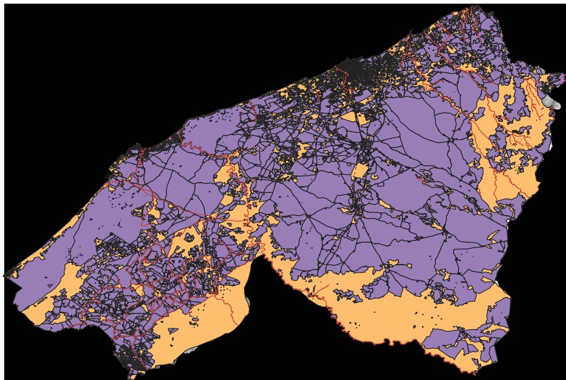

# Découpage des données - Casablanca‑Settat

Ce répertoire contient les couches géographiques **découpées** à l’emprise de la région Casablanca‑Settat. Les fichiers proviennent des sources brutes décrites dans le fichier `SOURCES.md` et ont été reprojetés en `EPSG:26191` (Merchich / Nord Maroc) afin d’assurer la cohérence spatiale pour les analyses d’inondation.

## Structure des fichiers

| Fichier | Description |
|---|---|
| `osm/` | Couches OSM découpées au format GeoPackage (`*.gpkg`).
| `limite_casablanca_settat.gpkg` | Polygone de la frontière administrative de la région, utilisé comme cadre de découpe.
| `couche_decoupee_qgis.png` | **Capture d’écran QGIS** montrant la couche découpée (preuve visuelle). *Remplacez ce fichier par votre vraie capture d’écran.*

## Utilisation

1. **Chargement dans QGIS** :
   - Ouvrez QGIS.
   - Utilisez *Add Vector Layer* → sélectionnez le GeoPackage souhaité.
   - Appliquez le style approprié (par exemple, couleur bleue pour les cours d’eau, gris pour les limites). 

2. **Vérification de la découpe** :
   - La capture d’écran `couche_decoupee_qgis.jpeg` illustre comment la couche raster/vectorielle a été restreinte à la zone d’étude.
   - Vous pouvez reproduire la même opération avec l’outil `Clip` de QGIS en utilisant le polygone `limite_casablanca_settat.gpkg` comme *Clipping layer*.
## Preuve d'écran (QGIS)

---

