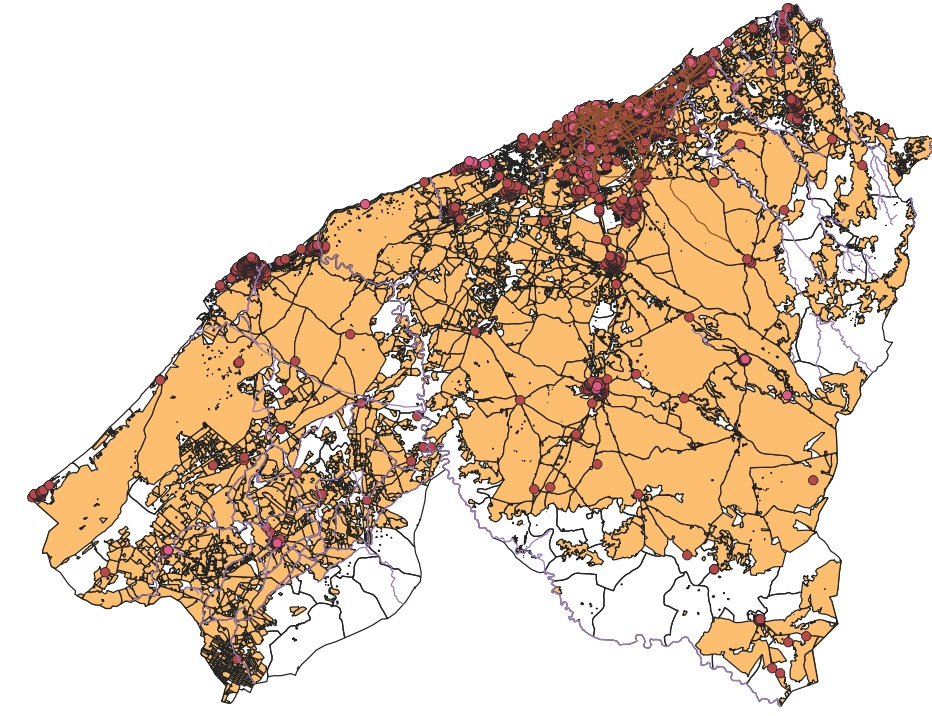

# Données traitées – GeoIA Inondation Casablanca

Ce répertoire regroupe les **couches géospatiales pré‑traitées** utilisées dans le cadre du projet **GeoIA Inondation Casablanca**.

- Les données proviennent d’OpenStreetMap (bâti, POI, occupation du sol, waterways), d’Overpass (réseau routier).
- Toutes les couches sont nettoyées, validées topologiquement et **reprojectées en `EPSG:26191`** (Merchich / Nord Maroc).

## Structure du répertoire

```

donnees_traitees/
├─ casablanca_settat_clean/   # Couches finales prêtes à être exploitées
│   ├─ bati_casablanca_settat_clean.gpkg
│   ├─ routes_casablanca_settat_clean.gpkg
│   ├─ occupation_sol_casablanca_settat_clean.gpkg
│   ├─ equipements_poi_casablanca_settat_clean.gpkg
│   ├─ infrastructures_secours_clean.gpkg
│   ├─ogis_osm_waterways_casablanca_settat_clean.gpkg
│   └─DEM_Grand_Casablanca_corrige.tif
├─ mailles/ 
├─ ahp/ 
├─ clustering/ 
├─ rasters/                    # Dossiers de maillage (créés ultérieurement)
│_  
└─ README.md                 
```

## Utilisation dans QGIS

1. Ouvrez QGIS.
2. **Ajouter une couche vecteur** → choisissez le fichier `.gpkg` souhaité dans `casablanca_settat_clean/`.
3. Vérifiez que le projet utilise le CRS `EPSG:26191` (menu *Project → Properties → CRS*).
4. Examinez les attributs

## Preuve d’écran (QGIS)




---

